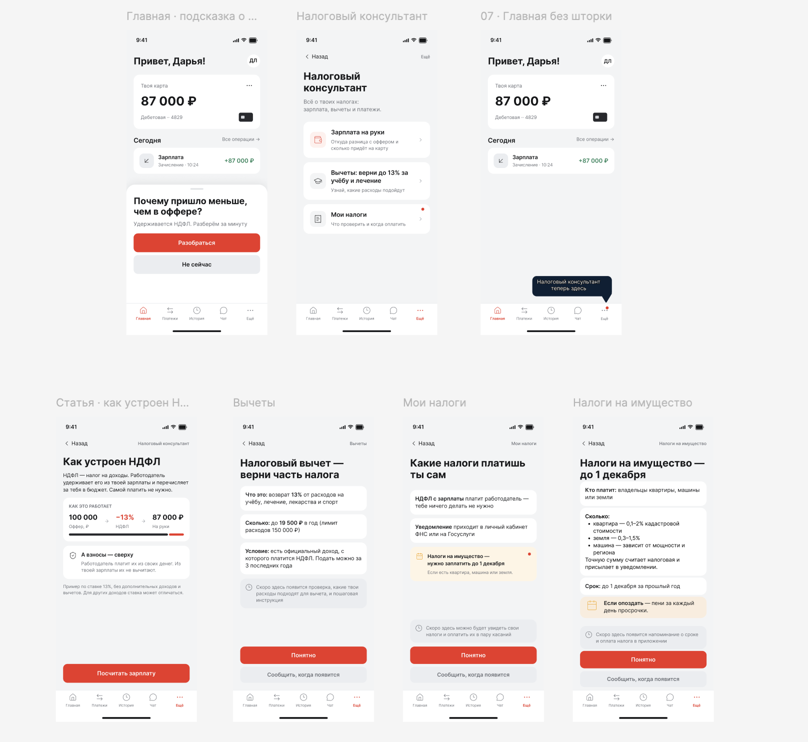
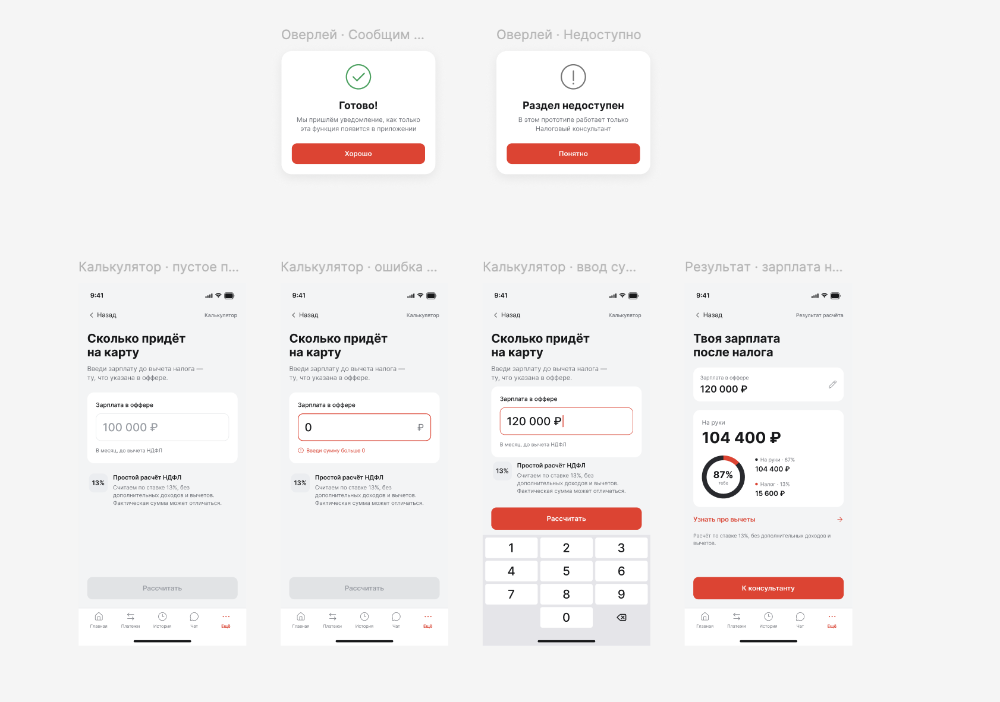

# "Tax Advisor" in the Alfa-Bank app

A product case study completed during the online product management practice by **Alfa-Future** (Alfa-Bank's education programme). The product was taken from idea to pitch: audience research, hypotheses, prototype, metrics, UX testing and defending the concept.

🔗 **[Clickable prototype in Figma](https://www.figma.com/proto/5uRcH0Q9rWcuCwDMKEGurR/%D0%A4%D0%B8%D0%BD%D0%B0%D0%BD%D1%81%D0%BE%D0%B2%D1%8B%D0%B9-%D0%BF%D0%BE%D0%BC%D0%BE%D1%89%D0%BD%D0%B8%D0%BA?node-id=2007-1817&p=f&t=Czewidr7OPK2DvK7-0&scaling=scale-down&content-scaling=fixed&page-id=0%3A1&starting-point-node-id=2007%3A1817)**

## About the product

**Problem.** Young professionals aged 20–24 receive their first salary and see less on their card than their job offer stated. They don't understand how personal income tax works, don't know about tax deductions and are afraid of making mistakes when paying taxes.

**Solution.** The advisor is built into the bank's app and appears on its own at the right moment — for example, when a salary is credited. It explains taxes in plain language, calculates take-home pay in a built-in calculator and suggests how to get part of the tax back through a deduction.

**North Star Metric:** number of users per month who solved a tax task in the advisor.

## Stages of work

| Lesson | Topic | What was done |
|:-:|---|---|
| 1 | [Getting to know the product](lesson-01-product-ideas.md) | Audience pain points, 5 ideas, idea selection |
| 2 | [Running research](lesson-02-research.md) | Research goal, hypotheses, in-depth interview guide |
| 3 | [Working with hypotheses](lesson-03-hypotheses.md) | 3 product hypotheses, validation methods, survey design |
| 4 | [Building a prototype](lesson-04-prototype.md) | Key scenario, flowchart, Figma prototype, hallway test |
| 5 | [Learning metrics](lesson-05-metrics.md) | North Star Metric, AARRR metrics |
| 6 | [Seeing through the user's eyes](lesson-06-ux-test.md) | Usability test plan and results |
| 7 | [Defending the idea](lesson-07-pitch.md) | Final pitch of the product concept |

*Lesson files are in Russian.*

## Tools and methods

Jobs To Be Done · in-depth interviews · product hypotheses · Fake door / Wizard of Oz / MVP · Figma · user flow · AARRR · North Star Metric · usability testing

---

*An educational concept; not an official Alfa-Bank product.*

# «Налоговый консультант» в приложении Альфа-Банка

Учебный продуктовый кейс, выполненный на онлайн-практике по управлению продуктом от **Альфа-Будущего**. Путь продукта пройден от идеи до питча: исследование аудитории, гипотезы, прототип, метрики, UX-тест и защита концепции.

🔗 **[Кликабельный прототип в Figma](https://www.figma.com/proto/5uRcH0Q9rWcuCwDMKEGurR/%D0%A4%D0%B8%D0%BD%D0%B0%D0%BD%D1%81%D0%BE%D0%B2%D1%8B%D0%B9-%D0%BF%D0%BE%D0%BC%D0%BE%D1%89%D0%BD%D0%B8%D0%BA?node-id=2007-1817&p=f&t=Czewidr7OPK2DvK7-0&scaling=scale-down&content-scaling=fixed&page-id=0%3A1&starting-point-node-id=2007%3A1817)**

## О продукте

**Проблема.** Молодые специалисты 20–24 лет получают первую зарплату и видят на карте меньше, чем было в оффере. Они не понимают, как работает НДФЛ, не знают о налоговых вычетах и боятся ошибиться с уплатой налогов.

**Решение.** Консультант встроен в приложение банка и сам появляется в нужный момент, например при зачислении зарплаты. Он объясняет налоги простым языком, считает зарплату на руки в калькуляторе и подсказывает, как вернуть часть налога через вычет.

**North Star Metric:** количество пользователей в месяц, которые решили налоговую задачу в консультанте.

## Этапы работы

| Урок | Тема | Что сделано |
|:-:|---|---|
| 1 | [Погружаемся в продукт](lesson-01-product-ideas.md) | Боли аудитории, 5 идей, выбор идеи |
| 2 | [Проводим исследования](lesson-02-research.md) | Цель исследования, гипотезы, гайд глубинного интервью |
| 3 | [Работаем с гипотезами](lesson-03-hypotheses.md) | 3 продуктовые гипотезы, методы проверки, дизайн опроса |
| 4 | [Делаем прототип](lesson-04-prototype.md) | Ключевой сценарий, блок-схема, прототип в Figma, коридорный тест |
| 5 | [Изучаем метрики](lesson-05-metrics.md) | North Star Metric, метрики по AARRR |
| 6 | [Смотрим глазами пользователя](lesson-06-ux-test.md) | План и результаты юзабилити-теста |
| 7 | [Защищаем идею](lesson-07-pitch.md) | Итоговый питч продуктовой концепции |

## Инструменты и методы

Jobs To Be Done · глубинные интервью · продуктовые гипотезы · Fake door / Wizard of Oz / MVP · Figma · user flow · AARRR · North Star Metric · юзабилити-тестирование

---

*Учебный концепт, не является официальным продуктом Альфа-Банка.*
