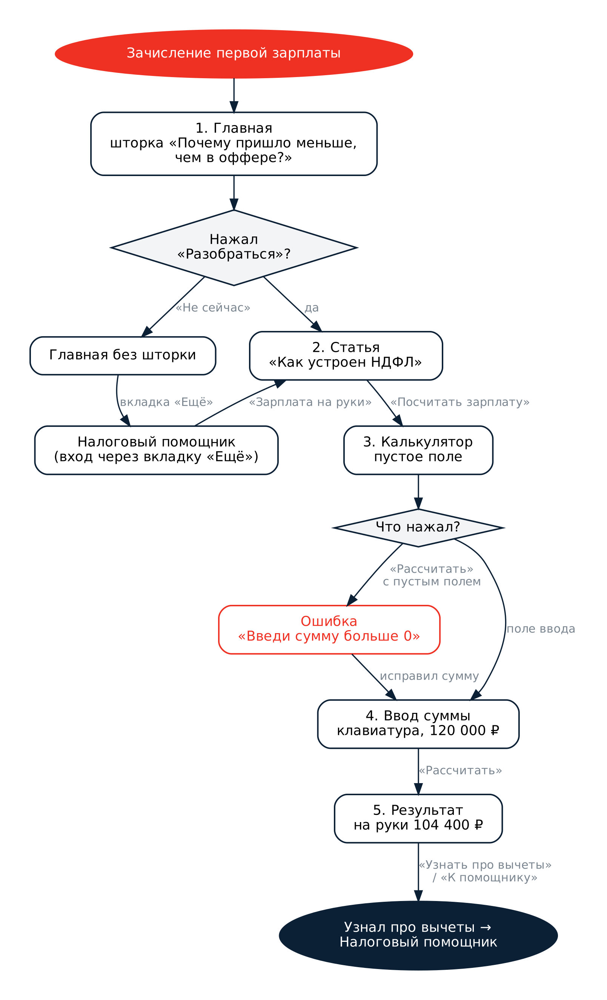
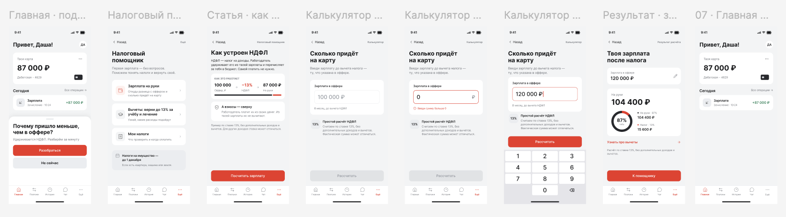

# Урок 4. Делаем прототип

> **Курс:** продуктовый курс Альфа-Банка («Приходи в Альфу» / Альфа-Будущее)
> **Задание:** выбрать ключевой сценарий, нарисовать блок-схему, собрать кликабельный прототип в Figma и провести коридорный тест
> **Идея из урока 1:** «Налоговый помощник» — подсказки и короткие статьи в приложении банка о том, как считается зарплата на руки, как оформить налоговый вычет и как оплатить налог
> **Автор:** Дарья Ляпун

🔗 **[Открыть кликабельный прототип в Figma](https://www.figma.com/proto/5uRcH0Q9rWcuCwDMKEGurR/Untitled?node-id=0-1ВСТАВЬ_ССЫЛКУt=Jm7xBul6gHUlPwSg-1)**

---

## Содержание

1. [Ключевой сценарий](#шаг-1-ключевой-сценарий)
2. [Блок-схема](#шаг-2-блок-схема-пользовательского-сценария)
3. [Прототип в Figma](#шаг-3-кликабельный-прототип-в-figma)
4. [Коридорный тест](#шаг-4-коридорный-тест)
5. [Результаты и выводы](#шаг-5-результаты-и-выводы)

---

## Шаг 1. Ключевой сценарий

**Сценарий:** «Понять, почему зарплата пришла меньше, чем в оффере».

Пользователь получает первую зарплату и видит в приложении шторку «Почему пришло меньше, чем в оффере?». Он открывает короткую статью о том, как работает НДФЛ, переходит в калькулятор, вводит сумму из оффера и видит, сколько придёт на руки и сколько уходит на налог. В конце он узнаёт, что часть налога можно вернуть через вычет, и переходит в «Налоговый помощник».

Это главный сценарий, потому что он срабатывает в момент, когда вопрос у пользователя уже возник: сразу после зачисления зарплаты.

---

## Шаг 2. Блок-схема пользовательского сценария

Квадраты — экраны, ромбы — развилки, стрелки — переходы.

**Развилки в сценарии:**
- **На главной** пользователь может сразу разобраться или закрыть шторку. Если он нажал «Не сейчас», помощник остаётся доступен через вкладку «Ещё».
- **В калькуляторе** пользователь может нажать на поле и ввести сумму (основной путь) или нажать «Рассчитать» с пустым полем и увидеть ошибку, после чего исправить сумму.

---

## Шаг 3. Кликабельный прототип в Figma

🔗 **[Открыть прототип](https://www.figma.com/proto/5uRcH0Q9rWcuCwDMKEGurR/Untitled?node-id=0-1ВСТАВЬ_ССЫЛКУt=Jm7xBul6gHUlPwSg-1)**

**Экраны:**

| № | Экран | Что на нём |
|:-:|-------|-----------|
| 1 | Главная · подсказка о зарплате | Зачисление зарплаты и шторка «Почему пришло меньше, чем в оффере?» |
| 2 | Статья · как устроен НДФЛ | Объяснение и схема «100 000 ₽ → −13% → 87 000 ₽ на руки» |
| 3 | Калькулятор · пустое поле | Поле «Зарплата в оффере», неактивная кнопка |
| 4 | Калькулятор · ввод суммы | Клавиатура, введено 120 000 ₽, активная кнопка «Рассчитать» |
| 5 | Результат · зарплата на руки | На руки 104 400 ₽, налог 15 600 ₽, диаграмма, переход к вычетам |
| — | Калькулятор · ошибка суммы | Состояние ошибки: введён 0, подсказка «Введи сумму больше 0» |
| — | Налоговый помощник | Разделы: зарплата на руки, вычеты, мои налоги |
| — | Главная без шторки | Состояние после нажатия «Не сейчас» |

**Решения при проектировании:**
- **Знакомые паттерны.** Шторка снизу, цифровая клавиатура iOS, таб-бар внизу, кнопка «Назад» слева сверху.
- **Все состояния поля ввода:** пустое, заполненное и с ошибкой.
- **Расчёт упрощён до ставки 13%.** На экране калькулятора есть пометка, что фактическая сумма может отличаться.
- **Ввод суммы имитируется отдельным экраном,** потому что прототип Figma не поддерживает реальный ввод текста.

---

## Шаг 4. Коридорный тест

**Респондент:** знакомый молодой человек из целевой аудитории.

**Как проходил тест:** я дала ему открытый прототип и попросила пройти сценарий самостоятельно, без подсказок, наблюдая за его действиями.

---

## Шаг 5. Результаты и выводы

### Что работало хорошо

- Ключевой сценарий пройден без затруднений: шторка на главной → статья о НДФЛ → калькулятор → результат.
- Переходы и кнопки «Назад» работали ожидаемо, вопросов о том, куда нажимать, не возникло.

### Что вызвало трудности

- На экране «Налоговый помощник» не нажимаются карточки **«Вычеты»** и **«Мои налоги»**. Респондент сразу это заметил и попытался на них нажать.
- Особенно заметна проблема на экране результата: ссылка **«Узнать про вычеты →»** ведёт в помощник, но сам раздел вычетов не открывается. Получается, прототип обещает пользователю информацию, которую не даёт.

### Выводы и что изменю в прототипе

1. **Добавлю заглушки на неработающие разделы.** По нажатию на «Вычеты» и «Мои налоги» будет открываться экран «Скоро появится» с кнопкой «Сообщить, когда будет готово». По сути это fake door из урока 3: он не только убирает тупик, но и позволяет измерить, сколько пользователей интересуются вычетами и оплатой налогов. Это поможет решить, какой раздел разрабатывать следующим.
2. **Изменю ссылку на экране результата.** Пока раздела вычетов нет, ссылка «Узнать про вычеты» будет вести на заглушку, а не в общий раздел помощника.
3. **В следующих тестах не буду ничего объяснять респонденту во время прохождения.** Когда он спросил про неработающие кнопки, я объяснила, что эти разделы ещё не проработаны. Но по правилам коридорного теста важно только наблюдать: сама реакция пользователя на «мёртвую» кнопку и есть ценный результат.
4. **Проведу ещё 1–2 теста** с людьми не из IT, чтобы проверить, насколько понятны статья о НДФЛ и результат калькулятора.
