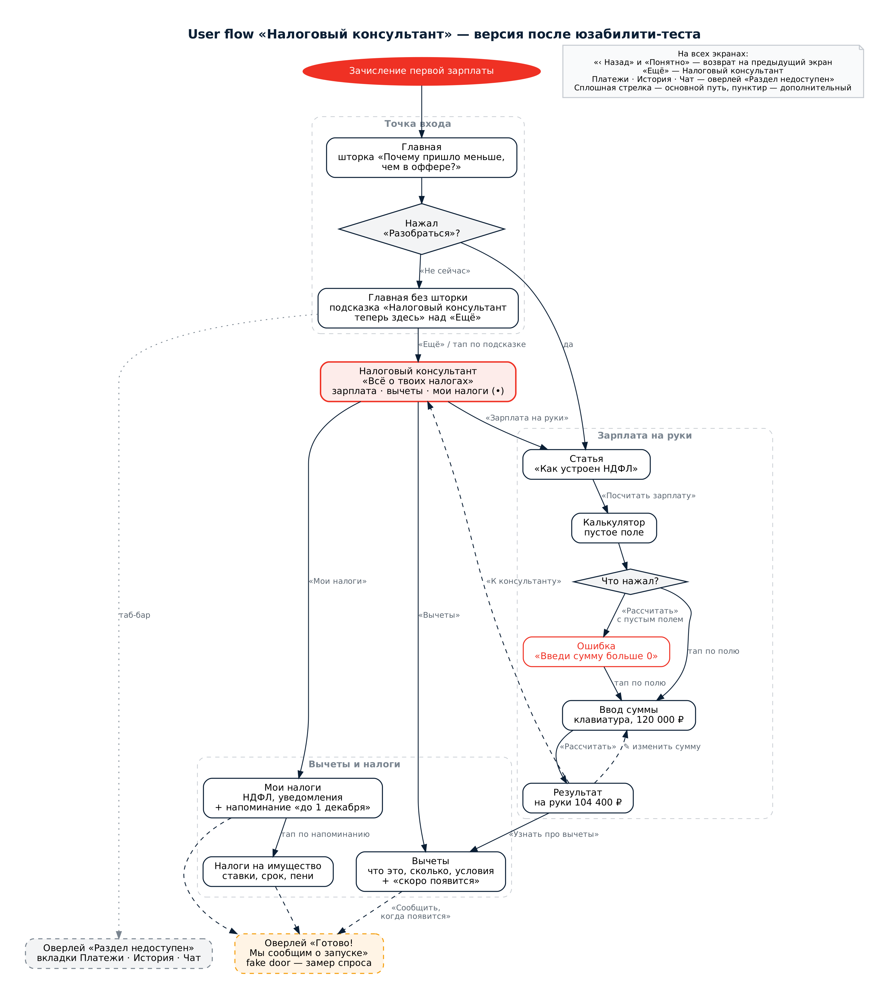

# Урок 6. Смотрим на продукт глазами пользователя

> **Курс:** продуктовый курс Альфа-Банка («Приходи в Альфу» / Альфа-Будущее)
> **Задание:** провести юзабилити-тест прототипа, зафиксировать проблемы и сформулировать рекомендации
> **Вариант:** Б — собственный прототип «Налоговый консультант»
> **Автор:** Дарья Ляпун

🔗 **[Прототип в Figma](https://www.figma.com/proto/5uRcH0Q9rWcuCwDMKEGurR/%D0%A4%D0%B8%D0%BD%D0%B0%D0%BD%D1%81%D0%BE%D0%B2%D1%8B%D0%B9-%D0%BF%D0%BE%D0%BC%D0%BE%D1%89%D0%BD%D0%B8%D0%BA?node-id=2007-1817&p=f&t=Czewidr7OPK2DvK7-0&scaling=scale-down&content-scaling=fixed&page-id=0%3A1&starting-point-node-id=2007%3A1817)**

---

## Шаг 1. Что тестирую

Кликабельный прототип фичи **«Налоговый консультант»** для приложения банка из урока 4. Консультант объясняет молодым специалистам, почему зарплата на руки меньше суммы в оффере, и помогает посчитать её в калькуляторе.

Экраны: главная с подсказкой о зарплате → статья о НДФЛ → калькулятор (пустое поле, ввод суммы, ошибка) → результат → раздел «Налоговый консультант».

---

## Шаг 2. Цель исследования

Проверить, насколько пользователям понятен путь от подсказки о зарплате до расчёта суммы на руки в калькуляторе, могут ли они самостоятельно найти «Налоговый консультант» в приложении, и выявить основные точки отказа и непонятные элементы интерфейса.

---

## Шаг 3. Критерии отбора респондентов

- Возраст 20–25 лет.
- Работают, стажируются или уже получали доход, с которого удерживается налог.
- Пользуются мобильным банковским приложением минимум раз в неделю.
- Не работают в IT, дизайне или финансах: у специалистов «замылен» глаз.
- Раньше не видели этот прототип.

---

## Шаг 4. Структура тестирования

### А. Онбординг

- Представлюсь: «Привет! Я учусь на курсе по продуктовому менеджменту и тестирую прототип новой функции банковского приложения».
- Объясню правила: «Мы проверяем приложение, а не тебя. Правильных и неправильных действий нет. Если что-то непонятно, значит, это недоработка интерфейса, а не твоя ошибка».
- Предупрежу, что это прототип: не все кнопки работают, и это нормально.
- Попрошу думать вслух: «Пожалуйста, проговаривай, что ты видишь, что ожидаешь и куда хочешь нажать».
- Предупрежу о длительности: около 10–15 минут.
- Попрошу разрешения на запись экрана и голоса для анализа и пообещаю, что запись никуда не будет передана.

### Общие вопросы (проверка соответствия критериям)

- Расскажи, где ты сейчас учишься или работаешь?
- Каким банковским приложением пользуешься и как часто?
- Сталкивался(-ась) ли с налогами: зарплата, вычеты, уведомления от налоговой?

### Б. Задачи для респондента

Формулирую как ситуации, без подсказок, куда нажимать:

1. **«Представь, что тебе пришла первая зарплата, и она меньше, чем было в оффере. Разберись, почему так получилось».**
   Успех: респондент открыл статью о НДФЛ.
2. **«Посчитай, сколько ты будешь получать на руки, если зарплата в оффере 120 000 ₽».**
   Успех: респондент дошёл до экрана результата с суммой 104 400 ₽.
3. **«Представь, что ты закрыл(а) подсказку о зарплате, а потом решил(а) снова разобраться с налогами. Найди раздел, где это можно сделать».**
   Успех: респондент нажал «Не сейчас» и нашёл «Налоговый консультант» через вкладку «Ещё».

Во время выполнения не подсказываю. Если респондент молчит, задаю нейтральные вопросы: «Что ты сейчас видишь?», «Что ожидаешь после нажатия?».

### В. Пост-тестовые вопросы

- Что было самым непонятным?
- Что бы ты изменил(а)?
- Оцени сложность выполнения задач по шкале от 1 до 5, где 1 — очень сложно, 5 — очень легко. Если оценка ниже 5, спрошу, почему.

### Завершение

- Поблагодарю за участие.
- Спрошу, можно ли написать, если появятся уточняющие вопросы.

---

## Шаг 5. Проведение тестов

**Количество респондентов:** 3
**Формат:** ссылка на прототип отправлена в Telegram, респонденты проходили его самостоятельно на телефоне и присылали комментарии и скриншоты в чат.
**Дата:** 26 октября 2026

| Респондент | Пол, возраст |
|:-:|---|
| Р1 | девушка, 20 лет |
| Р2 | парень, 21 год |
| Р3 | девушка, 24 года |

### Ограничения теста

- Респонденты исследовали прототип свободно, а не по трём сформулированным задачам.
- Тест был асинхронным: не было видно, где человек зависал, — только его комментарии.
- В ходе теста я объясняла, почему часть кнопок не работает. Это нарушает правило «не подсказывать» — в следующем тесте буду только наблюдать.
- Оценку сложности по шкале 1–5 не собирала.

---

## Шаг 6. Результаты

### Выполнение сценариев

| Сценарий | Р1 | Р2 | Р3 |
|---|:-:|:-:|:-:|
| Пройти путь до расчёта зарплаты | ✅ | ✅ | ✅ |
| Найти консультант после «Не сейчас» | не проверялось | не проверялось | не проверялось |

Р1: «Да всё понятно, просто клацать и переходить». Р3 нашла калькулятор, но отметила, что он «запрятан очень далеко».

_Критичность: **высокая** — не может выполнить задание; **средняя** — выполняет с трудом, долго или с ошибками; **низкая** — выполняет, но испытывает лёгкое неудобство._

### Наблюдения — Р1 (девушка, 20 лет)

| Что делала | Проблема | Критичность | Цитата |
|---|---|:-:|---|
| Нажимала вкладки таб-бара | Вкладки «Главная», «Платежи», «История», «Чат» не работают, и непонятно почему | Средняя | «Ничего не работает… Я про кнопки внизу», «Зачем неработающие кнопки в приложении» |
| Смотрела главный экран | Непонятно, что за аватар «ДА» | Низкая | «Кто такая ДА» |
| Пыталась ввести свою сумму в калькуляторе | Сумма зафиксирована, свою ввести нельзя | Средняя | «Нельзя поменять» |

### Наблюдения — Р2 (парень, 21 год)

| Что делал | Проблема | Критичность | Цитата |
|---|---|:-:|---|
| Пытался ввести сумму с клавиатуры | Клавиатура не работает, сумма подставляется сама | Средняя | «Не смог с клавы ввести» |
| Нажимал карандаш у суммы на экране результата | Иконка редактирования не работает | Средняя | «Не работают», «А отредактировать просто» |
| Нажимал таб-бар на экране консультанта | Вкладки не работают | Средняя | (обвёл таб-бар на скриншоте) |

### Наблюдения — Р3 (девушка, 24 года)

| Что делала | Проблема | Критичность | Цитата |
|---|---|:-:|---|
| Смотрела главный экран | Непонятно, что за кнопка «ДА» | Низкая | «Сходу не понятно, что за кнопка ДА сверху» |
| Нажимала таб-бар | Непонятно, какие элементы рабочие | Средняя | «У тебя сейчас только кнопка налоговый консультант работает, да?» |
| Читала статью о НДФЛ | Текст в женском роде («самой платить не нужно») | Низкая | «Там наверное должен быть мужской род» |
| Изучала экран консультанта | Подзаголовок только про зарплату, хотя раздел про все налоги | Средняя | «Не понятно, почему подпись сверху только про зарплату» |
| Изучала экран консультанта | «Налоги на имущество» вынесены отдельно от «Моих налогов» | Средняя | «Кажется, что „Мои налоги“ подразумевают все налоги» |
| Искала расчёт зарплаты | Калькулятор спрятан глубоко | Средняя | «Расчёт налогов с зарплаты запрятан очень далеко» |

### Сводный список проблем

| № | Проблема | Где | Столкнулись | Критичность |
|:-:|---|---|:-:|:-:|
| 1 | Неработающие вкладки таб-бара сбивают с толку | Все экраны | 3/3 | Средняя |
| 2 | Нельзя ввести или изменить свою сумму | Калькулятор, результат | 2/3 | Средняя |
| 3 | Нелогичная структура разделов консультанта | Консультант | 1/3 | Средняя |
| 4 | Калькулятор спрятан глубоко | Консультант | 1/3 | Средняя |
| 5 | Непонятный аватар «ДА» | Главная | 2/3 | Низкая |
| 6 | Текст в женском роде | Статья | 1/3 | Низкая |

Проблем высокой критичности не найдено: основной сценарий прошли все респонденты.

---

## Шаг 7. Инсайты и рекомендации

### Инсайты

1. **Люди воспринимают прототип как готовое приложение.** Все трое ожидали, что работает каждая кнопка. Границы прототипа нужно обозначать, а неработающие элементы должны реагировать, а не молчать.
2. **Пользователи хотят считать свою зарплату, а не смотреть пример.** Двое пытались ввести собственную сумму — это подтверждает ценность персонального калькулятора.
3. **Калькулятор важнее статьи.** Путь «статья → калькулятор» воспринимается как длинный.
4. **Структура раздела должна совпадать с ментальной моделью.** «Мои налоги» воспринимаются как все налоги пользователя, поэтому отдельный блок про имущество выглядел дублем.

### Самые критичные проблемы

Неработающие вкладки таб-бара (3 из 3 респондентов) и невозможность изменить сумму (2 из 3) — они сильнее всего ломают ощущение работающего продукта.

### Рекомендации и что уже исправлено в прототипе

| Проблема | Рекомендация | Статус |
|---|---|:-:|
| Неработающий таб-бар | Оверлей «Раздел недоступен. В этом прототипе работает только Налоговый консультант» на вкладках вне фичи | ✅ |
| Нельзя изменить сумму | Карандаш на результате ведёт обратно на экран ввода суммы. Реальный ввод в Figma невозможен, он реализуется в разработке | ✅ |
| Структура разделов | Подзаголовок «Всё о твоих налогах: зарплата, вычеты и платежи». Напоминание о налогах на имущество перенесено в «Мои налоги» и ведёт на подробный экран со ставками, сроком и пени | ✅ |
| Новый раздел легко пропустить | Красная точка на «Мои налоги» и подсказка «Налоговый консультант теперь здесь» над вкладкой «Ещё» | ✅ |
| Аватар «ДА» | Заменён на инициалы «ДЛ», приветствие — «Привет, Дарья!» | ✅ |
| Женский род | Нейтральные формулировки без рода | ✅ |
| Калькулятор спрятан | Добавить на экран консультанта прямую карточку «Посчитать зарплату на руки» | следующая итерация |

### Обновлённый пользовательский сценарий

Блок-схема прототипа после правок по итогам теста (исходная версия — в [уроке 4](lesson-04-prototype.md)):

### Готовность к разработке

Основной сценарий понятен всем респондентам, найденные проблемы средней и низкой критичности, большая часть уже исправлена в прототипе. Перед передачей в разработку нужна ещё одна итерация: добавить прямой вход в калькулятор и повторить тест — уже синхронно, по сформулированным задачам, без подсказок и со сбором оценки сложности.
